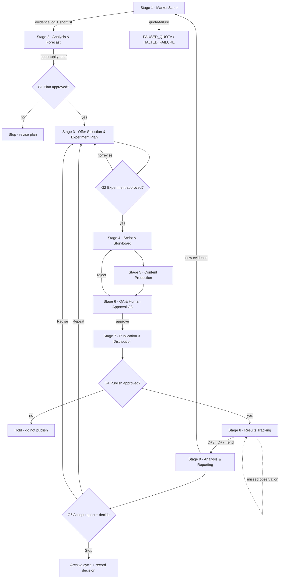

# B. End-to-End Workflow Specification — Affiliate Content Engine

Status: DRAFT FOR OWNER APPROVAL · Version 1.0 · 2026-10-11

This document defines the 10-stage workflow, per-stage states/transitions, decision rules, failure handling, and required evidence. It is written so that the first vertical slice (Doc E) is a strict subset of it.

**Convention:** every stage advances via a transition in the workflow state file (Doc D §2). Two special states are valid at any stage: `PAUSED_QUOTA` (external free quota exhausted → halt + owner report, never auto-switch to paid) and `HALTED_FAILURE` (unexpected error → halt + owner report before retry). Budget default is THB 0; any stage showing a cost estimate > THB 0 is blocked until G-pay approves it.

## Workflow diagram

## Stage definitions

Each stage lists: Purpose, Inputs, Actor, Actions, Outputs, Evidence, Cost/permission, Failure/recovery, State transitions, Acceptance criteria.

---

### Stage 1 — Market Scout / Market Intelligence

- **Purpose:** Gather market evidence about candidate niches, audience problems, products, offers, and competitor content; produce a shortlist of addressable opportunities.
- **Inputs:** Previous cycle learnings (or none in the first cycle); current affiliate-program availability (the account-referenced list in `docs/mission1/C-system-architecture.md` §4); operator's own interests/knowledge areas (best content comes from real familiarity).
- **Actor:** AI drafts research queries and summaries; **operator verifies every source** by opening the URL and confirming the finding; operator picks the shortlist.
- **Actions / decision rules:**
  1. AI proposes 3–5 niche candidates with: audience, problem, product categories, available programs, competition notes. Every market statement tagged Fact/Inference/Hypothesis/Unknown.
  2. Operator verifies sources; unverifiable claims move to Unknown and do not drive decisions.
  3. Operator selects ONE niche for slice 1 selection among the candidates. Third-party market observations never count as proof of our own sales potential — only as signals warrant an experiment.
- **Outputs:** Evidence records (≥1 per key claim), `opportunity brief` (draft).
- **Evidence required:** For each key claim: source name, URL, retrieval date, exact finding, note on methodology (if the source gives one) and limitations.
- **Cost/permission:** THB 0. Free tools only. G1 not yet required (this stage is research only).
- **Failure/recovery:** AI hallucinates a program/offer → operator verification fails → claim is marked Unknown and excluded. Too few candidates → widen search (still zero-cost), or pause and report if key free-tool quotas are exhausted (PAUSED_QUOTA). No recovery path silently changes niche mid-stage without owner note.
- **State transitions:** `NOT_STARTED → IN_PROGRESS → DRAFT_DONE (submitted for owner review)`; failure → `HALTED_FAILURE` or `PAUSED_QUOTA`.
- **Failure conditions:** (a) insufficient verifiable evidence for any candidate, (b) quota exhaustion, (c) contradiction between sources without resolution.
- **Acceptance:** ≥3 candidates documented with sources; 1 selected with reasons recorded; every load-bearing claim tagged.

---

### Stage 2 — Analysis & Forecast

- **Purpose:** Turn the selected opportunity into a clear hypothesis with explicit arithmetic and confidence.
- **Inputs:** Opportunity brief; program facts (commission rate, cookie/attribution window, payout terms) as verified on the program's own page/dashboard; our experiment capacity (channel setup, operator time).
- **Actor:** AI drafts the analysis; operator corrects facts and approves the brief's logic before Stage 3.
- **Actions / decision rules:**
  1. State the revenue hypothesis with explicit arithmetic: commission rate × conversion rate × traffic assumption × order value — each sourced or labeled ASSUMPTION.
  2. State risks and disqualifiers (e.g., minimum payout threshold not reachable in experiment duration, program requires 1,000 followers we do not have → offer is **not eligible**, pick another).
  3. Confidence level (L/M/H) with reasons.
- **Outputs:** `analysis brief` with hypothesis + arithmetic + confidence + risks.
- **Evidence required:** program facts from program's own source; every assumption labeled.
- **Cost/permission:** THB 0. No gate yet (G1 gates the plan as a whole).
- **Failure/recovery:** if arithmetic requires data we do not have (e.g., our channel's CTR), record as Unknown and set an estimate range with a note that the first experiment exists precisely to replace this Unknown with a Fact.
- **State transitions:** `NOT_STARTED → IN_PROGRESS → DRAFT_DONE → (implicit) ready for G2`.
- **Failure conditions:** hypothesis depends on Unavailable data (e.g., an API not verified to exist) → mark Unknown, and either choose a different offer or design the experiment to tolerate the unknown.
- **Acceptance:** hypothesis arithmetic explicit; every term sourced or labeled assumption; risks listed; confidence stated.

---

### Stage 3 — Offer Selection & Experiment Planning

- **Purpose:** Choose exactly one offer/program and design the smallest experiment that can confirm or refute the hypothesis.
- **Inputs:** Analysis brief; operator's channel assets (which platforms the operator can post on today); program-join status.
- **Actor:** AI drafts the experiment plan; **operator decides via Gate G2**.
- **Actions / decision rules:**
  1. Select ONE offer: product + program + link form + channel. Selection favors (a) programs confirmed joinable and paying out in THB-friendly ways, (b) offer terms visible in the logged-in dashboard, (c) content the operator can produce credibly.
  2. Define success criteria BEFORE starting (pre-registered): numeric, measurable from real dashboards, with a duration (default 14 days) and a schedule of observation points (D+3, D+7, end).
  3. Define cost budget (default THB 0). Any >0 triggers G-pay.
  4. Decision rule at end (defined now): confirm/reject/extend thresholds.
- **Outputs:** `experiment record` (Doc D §3) with status `PLANNED`.
- **Evidence required:** program/offer facts from dashboard screenshot where available; channel capability note (e.g., TikTok 1,000-follower gate if relevant to the planned link form).
- **Cost/permission:** THB 0 unless budget changed; **G2 required to proceed to Stage 4**.
- **Failure/recovery:** no eligible program → return to Stage 1 with the reason logged (not a silent retry). Program requires paid join or buy-in → stage blocks pending owner approval or owner decides to drop the offer.
- **State transitions:** `PLANNED → (G2 approved) → ACTIVE_SETTING_UP`.
- **Acceptance:** experiment record complete (hypothesis, offer, channel, success criteria, duration, budget, observation schedule); G2 decision logged.

---

### Stage 4 — Script & Storyboard

- **Purpose:** Draft the single content asset's script/storyboard with claim-to-evidence mapping and required disclosures.
- **Inputs:** Experiment record; evidence log entries for the product; channel policy notes (Doc C §6); disclosure requirements for AI use and commercial content.
- **Actor:** AI drafts; operator edits; final version submitted for G3.
- **Actions / decision rules:**
  1. Structure for one asset only (e.g., 30–60s short video: hook → problem → product demo/facts → call to action with the authorized link location).
  2. Every factual claim in the script maps to an Evidence ID; anything not mapped is cut or rewritten as opinion clearly labeled as such.
  3. Include the disclosure line/setting required by the channel; note any AI-use disclosure trigger if relevant.
  4. Use only the authorized link form for the channel; the script references the link placement, not a full URL in forbidden locations.
- **Outputs:** `script` v1 (in version history), claim map (claims → evidence IDs), disclosure plan.
- **Evidence required:** claim map; disclosure plan; version identifier.
- **Cost/permission:** THB 0. No gate (G3 follows production).
- **Failure/recovery:** claims lack evidence → operator either supplies evidence or claim is cut; if disclosure cannot be determined for the channel → treat as Unknown, do not publish, consult Doc G OQ-8 resolution path.
- **State transitions:** `DRAFTING → DRAFT_DONE → (production)`.
- **Acceptance:** every claim mapped; disclosure included; link form authorized; operator-edited final exists.

---

### Stage 5 — Content Production

- **Purpose:** Produce the approved script into one asset using free/existing tools.
- **Inputs:** Approved script; free tools available on the operator's computer (screen recorder, phone camera, free editors, AI tools within their free quota).
- **Actor:** Operator produces; AI may assist drafts of on-screen text/assets, but does not "render" final video in Slice 1 unless a free tool is verified.
- **Actions / decision rules:** production follows the storyboard; record tool list and free-quota use; if a free quota is exhausted mid-production → pause and report (PAUSED_QUOTA), never silently switch to paid.
- **Outputs:** content asset file (video/post), production metadata (tools used, AI use, quota state).
- **Evidence required:** asset file; production metadata note.
- **Cost/permission:** THB 0. No gate; passes directly to Stage 6.
- **Failure/recovery:** tool unavailable/free tier blocked → fall back to a simpler asset form (e.g., a well-composed static post with product screenshots) rather than paying; record fallback in run history.
- **State transitions:** `PRODUCING → PRODUCTION_DONE → (QA)`.
- **Acceptance:** asset exists, matches approved script; metadata recorded.

---

### Stage 6 — QA & Human Approval (Gate G3)

- **Purpose:** Owner approves content before any publication.
- **Inputs:** Asset, script final, claim map, disclosure plan, channel policy notes.
- **Actor:** Owner (sole approver). AI prepares the checklist but does not approve.
- **Actions / decision rules:** checklist review: (1) claim map present and valid, (2) disclosures present, (3) link form authorized, (4) no invented results/testimonials, (5) no platform-policy conflicts flagged. Approve / reject-with-reasons.
- **Outputs:** Decision record (G3) with date, result, reasons; if rejected: revision notes → back to Stage 4 with new version.
- **Evidence required:** decision record; the reviewed asset version hash/identifier.
- **Cost/permission:** THB 0. Gate mandatory.
- **Failure/recovery:** owner unavailable → workflow stays in `AWAITING_G3` (no timeout auto-approves).
- **State transitions:** `AWAITING_G3 → G3_APPROVED → (publication)` or `G3_REJECTED → (revision)`.
- **Acceptance:** recorded G3 decision covering all 5 checklist items.

---

### Stage 7 — Publication & Distribution (Gate G4)

- **Purpose:** Publish the approved asset on exactly one channel with the authorized affiliate link.
- **Inputs:** G3-approved asset; caption/hashtags/link kit; the operator's channel account; affiliate link from the program dashboard.
- **Actor:** Operator performs the actual publish manually inside the platform. The engine records what was published.
- **Actions / decision rules:**
  1. Apply required platform settings (commercial-content disclosure toggles; AI-use labels where required).
  2. Publish; capture immediate evidence: live post URL, timestamp, link form used, screenshot of live post.
  3. Record publication (Doc D §4). Engine must never auto-publish; if an automated option exists technically, it is out of scope in Slice 1.
- **Outputs:** `publication record` + evidence filename(s).
- **Evidence required:** live URL/screenshot/timestamp/link form.
- **Cost/permission:** THB 0. **Gate G4 approval (or operator-as-owner publish while logging it as the G4 record).**
- **Failure/recovery:** publish fails on platform side (moderation hold, upload error) → retry manually up to 2 times, then HALTED_FAILURE + owner report; nothing auto-retries beyond that. If a disclosure setting is missing/unclear → do not publish; raise to owner.
- **State transitions:** `PUBLISHED_LIVE → (Begin observation)`; hold → `PUBLICATION_ON_HOLD`.
- **Acceptance:** publication record complete with evidence.

---

### Stage 8 — Results Tracking & Measurement

- **Purpose:** Collect real outcome evidence on a fixed schedule, without automation assumptions.
- **Inputs:** Publication record; program dashboard (affiliate stats); platform analytics (post-level reach/clicks where available).
- **Actor:** Operator captures; AI can help format/total the captured data but never supplies values.
- **Actions / decision rules:**
  1. Scheduled captures at D+3, D+7, experiment end: anatomy of each capture = (a) platform analytics screenshot/export, (b) affiliate-dashboard screenshot/export of clicks, orders, commission status, refunds — for the relevant date range only.
  2. Each capture becomes a Result observation record with source + method + capture timestamp.
  3. Distinguish: reach/engagement ≠ clicks ≠ orders ≠ confirmed commissions ≠ paid-out commissions. Never conflate stages in reporting.
  4. If a dashboard changes its reporting (fields move/renamed) → record that in the run log; re-derive meaning before comparing.
- **Outputs:** 3 (or more) Result observation records, evidence files.
- **Evidence required:** per capture: source, method, timestamp, values, open questions.
- **Cost/permission:** THB 0. No gate (entry triggered by schedule end or owner).
- **Failure/recovery:** missed observation window → proceed with best available, but note the gap explicitly in the report; dashboard data unavailable (not yet visible) → record Unknown + note the observation retry at the next scheduled point.
- **State transitions:** `OBSERVING → OBSERVATIONS_COMPLETE → (analysis)`.
- **Acceptance:** observations exist for the defined schedule or gaps are explicitly recorded as Unknown.

---

### Stage 9 — Analysis, Learning & Reporting (Gate G5)

- **Purpose:** Compare hypothesis to actuals, extract learnings, produce the cycle report, and decide next action.
- **Inputs:** All Result observations; experiment record (pre-registered success criteria); evidence log.
- **Actor:** AI drafts the report; Owner accepts/decides (G5).
- **Actions / decision rules:**
  1. Compute pipeline: reach → clicks → orders → confirmed commission → net income (using the formula in Doc A FR-8.3).
  2. Compare against pre-registered criteria; report "confirm / reject / inconclusive" against each.
  3. Tag every claim Fact/Inference/Hypothesis/Unknown. List all data gaps (e.g., cannot yet confirm pending commission; payout lag unknown).
  4. Assess the THB 1,000/day objective only via the stated net-income definition, and state whether it is achieved/not achieved/not yet measurable in the observation window.
  5. Recommend action (Repeat / Revise / Stop) with rationale; Owner decides.
- **Outputs:** Cycle report; G5 decision record; updated learnings archive.
- **Evidence required:** each report line traces to Result observation / Evidence IDs; decision record.
- **Cost/permission:** THB 0.
- **Failure/recovery:** insufficient data for a confident decision → report says so; owner decides whether to extend observation, revise, or stop. No automatic re-run.
- **State transitions:** `DRAFTING_REPORT → AWAITING_G5 → DECIDED → (archive + next cycle or stop)`.
- **Acceptance:** cycle report complete; decision recorded with rationale; loop state archived.

---

### Stage 10 — Feedback into the next cycle

- **Purpose:** Feed verified outcomes and learnings into the next Stage 1.
- **Inputs:** Cycle report; G5 decision; archived learnings.
- **Actor:** Operator opens the next cycle with Stage 1; AI proposes which learnings to carry forward (only tagged/sourced ones).
- **Actions / decision rules:** next cycle's Stage 1 must begin from the previous cycle's decision, not from scratch; only learnings with evidence attached may be carried forward as Facts or Inferences; hypotheses may be retested.
- **Outputs:** next cycle's opportunity brief carrying forward verified learnings.
- **Evidence required:** links to prior cycle records.
- **Cost/permission:** THB 0.
- **Failure/recovery:** none — this is a handoff; if learnings are missing, next cycle notes that and proceeds.
- **Acceptance:** next brief cites prior cycle records explicitly.

## Global failure conditions & recovery summary

| Condition | Detected by | Response |
|---|---|---|
| Free quota exhausted | Any stage touching an external tool | PAUSED_QUOTA → report owner → wait/refill/redesign (free path only) |
| Halluccinated/unverifiable claim | Operator source verification | Mark Unknown, exclude from decision logic; log in run history |
| Publication blocked by platform | Stage 7 execution | Retry ≤2 manually, then HALTED_FAILURE + owner |
| Missed observation window | Stage 8 schedule | Proceed with best available + explicit Unknown rows in report |
| Approval gate pending (G1–G5) | Any stage awaiting gate | Workflow halts; no timeout auto-approves; owner decides |
| Budget > THB 0 detected | Cost field check | Stage blocks until G-pay approval record exists |
| Engine attempts a restricted action | Run history guard | HALTED_FAILURE + owner report (see Doc A §7) |
| Dashboard reporting changed | Stage 8 capture | Re-derive meaning; note in run history before comparisons |

## Manual fallback policy

If any integration, API, tool, or automation is unavailable or unverified, the workflow must be completable **manually** with the same evidence standards. Manual execution is acceptable; understated evidence is not.
