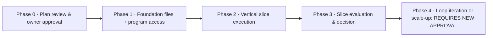

# F. Implementation Roadmap — Affiliate Content Engine

Status: DRAFT FOR OWNER APPROVAL · Version 1.0 · 2026-10-11

**CRITICAL:** Phases beyond Phase 0 describe work the owner has **not yet authorized**. Only Phase 0 (this planning deliverable, for review) is "done" when the owner approves this document set. Every subsequent phase requires its own approval decision at its exit gate. Do not treat this roadmap as permission.

## Dependency sketch

## Phase 0 — Plan Review & Approval (done when this doc set is approved)

- **Objective:** owner approves the plan (all Deliverables A–H).
- **Scope:** read + comment; no implementation.
- **Deliverables:** approval decision (via a G1-style Decision record in the repo, if the owner wants that on record).
- **Verification:** owner's explicit decision recorded.
- **Risks/exit:** plan rejected → revise deliverables; plan approved → Phase 1 authorized for its own scope only.
- **Duration:** owner-dependent (0.5–2 hours of reading).

## Phase 1 — Foundation & Access (THB 0)

- **Objective:** set up the minimum foundations and confirm program/channel access reality.
- **Scope:**
 1. Create `data/mission1/` structure + workflow-state/run-history/cost-budget files (file creation only, per Doc D; no automation logic needed).
 2. **Program applications (operator):** apply to ACCESSTRADE TH (primary) and direct Shopee TH + TikTok Shop affiliate if operator's TikTok meets the ≥1,000-follower gate; record application dates & statuses as Evidence.
 3. **Channel readiness:** check eligibility of planned channel accounts in-app (TikTok profile-link gate, Meta native affiliate availability) and record findings as Evidence.
 4. **Policy checklist file:** one-page per-channel publish checklist built from Doc C §6 sources (to be re-verified at publish time).
 5. **Niche scouting kickoff (Stage 1):** first evidence log entries, 3+ candidate briefs.
- **Deliverables:** data folder populated; program/channel status evidence recorded; Stage-1 candidate briefs.
- **Verification method:** files exist; evidence log has ≥5 sources with retrieval dates; program application status visible/recorded for ≥1 program; AC-01 partially exercised.
- **Risks:** program rejects operator → revisit offer/channel selection (shade the experiment); TikTok follower gate not met → choose a non-follower-gated channel for slice 1 (e.g., FB page with bio link).
- **Exit criteria:** ≥1 program confirmed joined/joinable + 1 channel confirmed publishable + Stage-1 shortlist selected → unlock G2 for Phase 2.
- **Estimated effort:** 2–4 operator evenings.
- **Costs:** THB 0.

## Phase 2 — Vertical Slice Execution (THB 0)

- **Objective:** execute Stages 2–8 once, end to end.
- **Scope:** experiment planning + G2 → script/claim map → produce 1 asset → G3 → publish with disclosures → observation schedule (D+3, D+7, end over default 14d window).
- **Deliverables:** EXP/SCR/asset/PUB/OBS records per Doc D; asset published live.
- **Verification method:** walkthrough against Doc E scenarios AC-02..AC-07 as they occur; run history kept current.
- **Risks:** production tooling friction (fallback: simpler asset form); platform moderation hold (retry ≤2 then halt); dashboard fields unclear (record Unknown, keep going).
- **Exit criteria:** experiment window elapsed with ≥3 observations captured.
- **Estimated effort:** ~5–8 hours spread over the window (production heaviest).
- **Costs:** THB 0 (default budget).

## Phase 3 — Evaluation & Learning (THB 0)

- **Objective:** complete Stage 9/10: analysis, cycle report, G5 decision; test evidence-backed go/no-go.
- **Scope:** pipeline analysis, criteria verdicts, learnings archive, objective assessment window; G5 decision; archive cycle.
- **Deliverables:** Cycle Report (RPT), G5 decision, learnings carried into next cycle's Stage 1.
- **Verification method:** Doc E AC-08 walkthrough (traceability) + owner's satisfaction that every number traces to evidence.
- **Risks:** inconclusive data (normal for first slice) — decision may be REVISE with changed success criteria; that's a valid exit, not a failure.
- **Exit criteria:** G5 recorded; slice formally closed.
- **Estimated effort:** 2–3 hours.
- **Costs:** THB 0.

## Phase 4 — Iteration / Scale-up (requires explicit new approval)

- **Objective:** based on the G5 decision, either (a) run cycle 2 with revised parameters, or (b) evaluate whether any recurring paid tool is justified by actual confirmed income (constructing that case would be a new proposal, not an automatic next step).
- **Scope:** TBD by G5 decision + owner input. Contingent items (e.g., paid ads profitability, second simultaneous offer, publish automation) remain excluded until this phase is separately approved.
- **Exit criteria:** new cycle in flight or deliberate stop; owner's decision logged.
- **Costs:** unknown; requires G-pay per proposal.

## 7. Future Considerations — Not Approved for Implementation

Nothing here may be built, purchased, or attempted without a new recorded owner decision (G1-class approval). Registry only.

- Paid-ad profitability analysis or any autonomous paid-ad management.
- Spending money to validate demand before a justified experiment with explicit G-pay approval.
- Large-scale or scheduled automatic publishing (including platform API posting).
- Multi-agent orchestration or complex automation frameworks.
- Advanced forecasting models before enough own-data exists (several completed cycles).
- Separate dashboards/analytics infrastructure beyond the markdown cycle report.
- Multiple simultaneous offers or experiments before cycle 1 is evaluated.
- Any paid subscription/tool (including link-in-bio paid tiers, editing suites, AI tools beyond free quotas).
- Cross-channel orchestration, affiliate-API integrations (ACCESSTRADE/ClickBank APIs), payout-lag automation.
- Rationale: none of these materially helps validate the FIRST revenue hypothesis; each adds cost or risk before evidence justifies it.

## Smallest first implementation step

After plan approval, **the literal first implementation step is**: create `data/mission1/workflow-state.yaml` + `run-history.yaml` + `cost-budget.yaml` (empty templates) and write the first `evidence-log.md` entry for the first researched source. Nothing else. This can be done in one operator-assisted session of < 1 hour and immediately exercises the workflow state discipline.

## What needs external verification (not assumed)

- Operator's actual acceptance by ACCESSTRADE/program dashboards; per-campaign commission rates visible only in-dashboard.
- In-app eligibility rules for TikTok profile links, Meta native affiliate, and any specific channel's AI-label flows.
- Actual click-tracking visibility per program (some show clicks, some only orders).
- Payout-lag reality for the chosen program (needed for cash-flow math and the "confirmed commission" concept).
